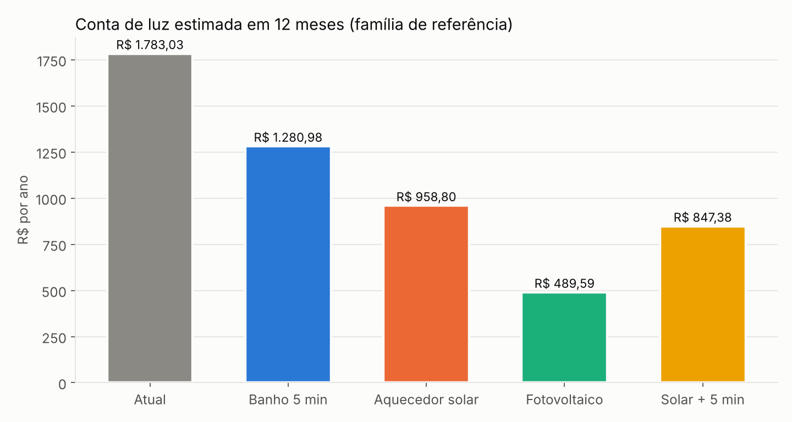
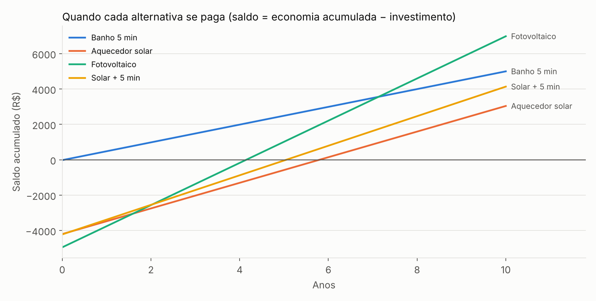

# Citizen Assist AI — Módulo de Energia e Sustentabilidade

**Global Solution 2026.2 · Ciência da Computação · Turma 1CCPJ · Contribuição da disciplina _Soluções em Energias Renováveis e Sustentáveis_**

> Este repositório (ou esta pasta, se o repositório for compartilhado com outras disciplinas) contém **apenas a contribuição de Energia** ao Citizen Assist AI.

## Integrantes

| Integrante (trabalho individual) | RM |
|---|---|
| Felipe Macedo | RM570990 |

---

## 1. Público e problema

**Público:** famílias de baixa renda que moram em casas na área da Enel SP (capital e Grande São Paulo), muitas delas beneficiárias da Tarifa Social de Energia, e que aquecem a água do banho com **chuveiro elétrico**.

**Necessidade energética:** o chuveiro elétrico é o aparelho que mais pesa na conta dessas famílias. Na família de referência (4 pessoas, banhos de 8 min, 220 kWh/mês) ele consome **~85 kWh/mês, ~38% da conta**, e puxa **5,3 kW** justamente no horário de pico do sistema elétrico (18h–21h).

**Como o assistente ajuda:** o cidadão pergunta em linguagem simples ("quanto meu chuveiro gasta?", "vale a pena aquecedor solar?") e recebe orientação com números calculados, fontes e limitações. Também pode simular com os dados da própria conta de luz.

Detalhes em [`docs/01_contexto.md`](docs/01_contexto.md).

## 2. Resultado da análise (12 meses, família de referência)

Comparamos **quatro alternativas para a mesma necessidade** (aquecer a água do banho) no **mesmo período** (12 meses), incluindo **duas fontes renováveis**:

| Alternativa | Renovável | Investimento | Economia líquida/ano | Retorno | CO₂ evitado | Alívio no pico |
|---|---|---|---|---|---|---|
| Banhos de 5 min (hábito) | não | R$ 20 | R$ 502 | imediato | 15 kg | 0 kW |
| **Aquecedor solar de água** + chuveiro de apoio | **sim** | R$ 4.199 | R$ 724 | 5,8 anos | 28 kg | 3,7 kW |
| **Placas fotovoltaicas** (1,1 kWp) | **sim** | R$ 4.950 | R$ 1.193 | 4,1 anos | 54 kg | 0 kW |
| Aquecedor solar + banhos de 5 min | sim | R$ 4.219 | R$ 836 | 5,0 anos | 32 kg | 3,7 kW |




**Recomendação do assistente:**
1. **Hábito primeiro** — custo zero e economia imediata. Parte do ganho vem do degrau do ICMS de SP (a conta cai abaixo de 200 kWh e a alíquota cai de 18% para 12%).
2. **Aquecedor solar** para quem tem casa própria e telhado com sol — é a única opção que alivia o pico do fim da tarde e não depende de regras de compensação.
3. **Fotovoltaico** tem o menor custo por kWh evitado, mas exige o maior desembolso inicial, homologação, e fica menos favorável com o Fio B subindo até 2028 — recomendado com ressalvas.

Esses números **são estimativas**, não garantias: a [análise de sensibilidade](docs/04_calculos_gerados.md#6-análise-de-sensibilidade) mostra, por exemplo, que o retorno do aquecedor solar vai de 5 para **11,6 anos** se a casa precisar de obra.

Justificativas completas (custos, viabilidade, impactos ambientais): [`docs/05_recomendacoes.md`](docs/05_recomendacoes.md).

## 3. Funcionalidades de energia no assistente

| O cidadão pergunta… | O assistente responde com… |
|---|---|
| "Quanto meu chuveiro gasta?" | potência, kWh/mês, % da conta, custo por minuto de banho |
| "Como economizar no banho?" | ações em ordem de impacto + explicação do degrau do ICMS |
| "Vale a pena aquecedor solar?" | custo, economia, retorno, quando faz sentido e quando não |
| "E placa fotovoltaica?" / "o que é Fio B?" | dimensionamento, custo, retorno, regras da Lei 14.300 |
| "Compare as opções" | tabela das 4 alternativas + recomendação em ordem |
| "Tenho direito à tarifa social?" | regra da Lei 15.235/2025 e como pedir |
| "Qual o impacto no meio ambiente?" | CO₂ evitado, efeito no pico, impactos da fabricação |
| "Qual a bandeira?" | bandeira do mês e quanto ela pesa no banho |
| "Placa solar zera a conta?" | resposta direta (não zera) com a conta antes e depois |
| "Moro de aluguel / em apartamento" | o que funciona sem telhado próprio |
| "E se a tarifa aumentar?" | economia recalculada com tarifa +10% |
| "O que é kWh / Fio B / homologação?" | glossário em linguagem simples |
| "De onde vêm esses números?" / "isso é garantido?" | lista de fontes / limitações |
| `simular` | cálculo personalizado com pessoas, minutos de banho, kWh da conta (ou "não sei"), Tarifa Social e tipo de moradia |

**Toda resposta principal começa com um resumo de uma frase, e toda resposta com número traz as fontes usadas e as limitações da estimativa.** As respostas são geradas a partir do motor de cálculo, então análise e orientação nunca divergem (há teste automatizado garantindo isso).

## 4. Como executar

Requisitos: Python 3.10+.

```bash
pip install -r requirements.txt

# Conversa interativa (digite "simular" para usar seus dados)
python -m citizen_energia

# Resposta única (útil para demonstração)
python -m citizen_energia "vale a pena aquecedor solar?"

# Regerar memória de cálculo, CSVs e gráficos após mudar um parâmetro
python -m citizen_energia.relatorio

# Rodar os testes automatizados (74 testes)
python -m pytest -q
```

### Integração com o Citizen Assist AI do grupo

```python
from citizen_energia.integracao import e_assunto_de_energia, responder_para_citizen_assist, contexto_para_llm

if e_assunto_de_energia(mensagem):
    resposta = responder_para_citizen_assist(mensagem)   # dict: texto, fontes, limitacoes...

# Se o assistente principal usa um LLM, injete os números calculados no prompt:
prompt_sistema += contexto_para_llm()   # dados + regras: não inventar valores, citar fontes, avisar limitações
```

## 5. Estrutura do repositório

```
citizen_energia/
  dados/parametros.json    # TODOS os dados: valor, unidade, tipo (PUBLICO/MERCADO/ESTIMADO), fonte
  dados/referencias.json   # fontes verificáveis (R01..R20)
  calculos.py              # física do chuveiro, conta de luz, 5 alternativas, VPL, sensibilidade
  assistente.py            # intenções + respostas (sempre com fontes e limitações)
  integracao.py            # API para o assistente principal e contexto para LLM
  relatorio.py             # gera memória de cálculo, CSVs e gráficos
  __main__.py              # interface de conversa
dados_resultados/          # CSVs gerados (comparação, mês a mês, sensibilidade)
docs/
  01_contexto.md           # público, necessidade, como o assistente contribui
  02_dados_e_premissas.md  # origem dos dados, unidades, período, o que é estimado
  03_metodologia.md        # fórmulas e modelagem das alternativas
  04_calculos_gerados.md   # memória de cálculo completa (gerada pelo código)
  05_recomendacoes.md      # custos, viabilidade, impactos ambientais, justificativas
  06_referencias.md        # referências
  07_limitacoes.md         # condições e limites das estimativas
  08_uso_de_ia.md          # como IA generativa foi usada e verificada
  roteiro_video.md         # roteiro do vídeo de 3 minutos
  img/                     # gráficos
testes_usuarios/           # protocolo, registro (personas simuladas), ajustes, transcrição
tests/                     # testes automatizados (pytest)
entrega.txt                # modelo do arquivo de entrega
```

## 6. Referências, limitações e testes

- Referências: [`docs/06_referencias.md`](docs/06_referencias.md)
- Limitações: [`docs/07_limitacoes.md`](docs/07_limitacoes.md)
- Testes: [`testes_usuarios/`](testes_usuarios/). Avaliação com **5 personas simuladas** (trabalho individual; não são pessoas reais), executada no assistente real em duas rodadas. Perguntas não entendidas caíram de 7/18 para 0/18, e foram feitos 10 ajustes. Resultados em [`03_registro_testes.md`](testes_usuarios/03_registro_testes.md), ajustes em [`04_ajustes_realizados.md`](testes_usuarios/04_ajustes_realizados.md) e transcrição em [`05_transcricao_personas.md`](testes_usuarios/05_transcricao_personas.md).
